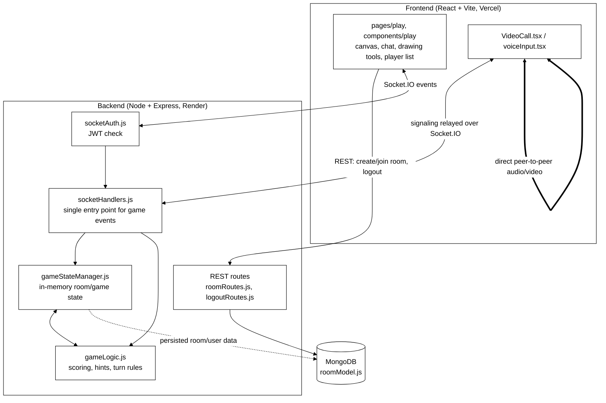

# SketchBattle — Architecture

## High-level architecture

SketchBattle splits into two deployed units: a Vite-built React frontend on Vercel, and a Node and Express backend on Render, communicating over REST for one-off actions and Socket.IO for everything that happens during a live game.

REST handles the parts of the app that aren't time-sensitive: logging out, and room creation or lookup, through `roomController.js` and `logoutController.js`. Once a player is inside a room, the game itself runs entirely over Socket.IO. `socketHandlers.js` is the single entry point for every real-time event a client sends, and it delegates rather than doing the work itself.

Behind that entry point sit two services with a clear division of labor. `gameStateManager.js` owns the in-memory state of each room: who's in it, whose turn it is, current scores, round timers. `gameLogic.js` owns the rules: scoring calculations, hint reveal timing, turn rotation. Keeping these separate means a bug in scoring math can't silently corrupt room membership state, and vice versa. `socketAuth.js` sits in front of both as middleware, checking the JWT before game events get processed.

Persistence is minimal by design. `roomModel.js` and MongoDB (via `dbconnection.js`) store what needs to survive a server restart, room and user records. Everything that's purely runtime, active game state, current drawer, elapsed round time, lives in memory inside `gameStateManager.js` and gets discarded when a room empties out.

Voice and video don't touch the backend's game logic at all. `VideoCall.tsx` and `voiceInput.tsx` on the frontend establish WebRTC peer connections directly between clients. The backend's only role is relaying the signaling messages (offer, answer, ICE candidates) needed to establish those connections, over the same socket layer as everything else.

On the frontend, `pages/landing` and `pages/play` are the two real screens: pick or create a room, then play. Inside play, `components/play` holds the active-game UI, canvas, chat, drawing tools, player list, and the three modals that interrupt gameplay at specific moments (word selection, round results, game end).



## Technology stack

Frontend: React 18 with TypeScript, built with Vite, styled with Tailwind CSS, deployed to Vercel.

Backend: Node.js with Express, deployed to Render.

Real-time transport: Socket.IO, used for all in-game events and WebRTC signaling.

Database: MongoDB, accessed through Mongoose.

Authentication: JWT, checked on both REST requests and Socket.IO events.

Peer-to-peer media: WebRTC, for in-room voice and video.

## Folder structure

```
SketchBattle/
├── backend/
│   ├── config/
│   │   └── gameConfig.js          # constants: scoring, timers
│   ├── controllers/
│   │   ├── logoutController.js
│   │   └── roomController.js
│   ├── db/
│   │   └── dbconnection.js        # MongoDB connection setup
│   ├── handlers/
│   │   └── socketHandlers.js      # single entry point for all socket events
│   ├── middleware/
│   │   └── socketAuth.js          # JWT check before game events are processed
│   ├── models/
│   │   └── roomModel.js
│   ├── routes/
│   │   ├── logoutRoutes.js
│   │   └── roomRoutes.js
│   ├── services/
│   │   ├── gameLogic.js           # scoring, hints, turn rules
│   │   └── gameStateManager.js    # in-memory room and game state
│   ├── utils/
│   │   └── gameUtils.js
│   ├── .env
│   ├── index.js                   # server entry point
│   └── package.json
│
└── frontend/
    ├── public/
    ├── src/
    │   ├── assets/
    │   ├── components/
    │   │   └── play/
    │   │       ├── modals/
    │   │       │   ├── gameEndModal.tsx
    │   │       │   ├── roundResultModal.tsx
    │   │       │   └── wordSelectModal.tsx
    │   │       ├── canvas.tsx
    │   │       ├── chatSection.tsx
    │   │       ├── drawingtools.tsx
    │   │       ├── navbar.tsx
    │   │       ├── playerList.tsx
    │   │       ├── VideoCall.tsx
    │   │       └── voiceInput.tsx
    │   ├── hooks/
    │   │   └── useVoiceFeedback.ts
    │   ├── pages/
    │   │   ├── landing/
    │   │   │   └── page.tsx
    │   │   └── play/
    │   │       └── page.tsx
    │   ├── types/
    │   │   └── types.ts
    │   ├── utils/
    │   │   └── backend_url.ts
    │   ├── App.tsx
    │   ├── index.css
    │   ├── main.tsx
    │   └── vite-env.d.ts
    ├── .env
    ├── eslint.config.js
    ├── index.html
    ├── package.json
    ├── tailwind.config.js
    ├── tsconfig.json
    ├── vercel.json
    ├── vite.config.ts
    └── README.md
```