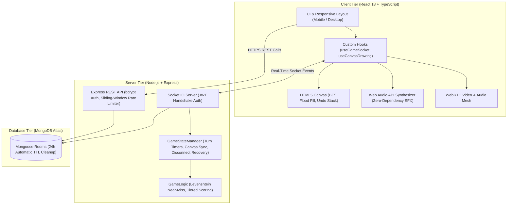

# SketchBattle

<div align="center">
  
  
  
  
  
  <a href="https://github.com/kushGupta-15/SketchBattle/actions/workflows/ci.yml">
    
  </a>
</div>

<div align="center">
  <h3>Real-time multiplayer drawing and guessing game inspired by Skribbl.io</h3>
  <p>Draw, guess, and have fun with friends in real-time!</p>

  <h2><a href="https://sketch-battle-rho.vercel.app/" target="_blank">Play Now</a></h2>

  <a href="https://sketch-battle-rho.vercel.app/" target="_blank">
    
  </a>
</div>

---

## Features

- **Interactive Drawing Canvas** - Smooth drawing with brush, eraser, high-speed 4-way BFS flood fill paint bucket, and stroke undo stack (`Ctrl+Z`)
- **Sound Effects Synthesizer** - Zero-dependency Web Audio API synthesizer for instant SFX (turn start, correct guess, close guess alert, time warning tick, penalty buzzer, victory fanfare) with a quick mute toggle
- **Mobile-First Responsive Design & Main-Screen Guess Bar** - On phones and small screens, the live chat feed and answer input bar are placed directly on the main screen beneath the canvas for effortless mobile guessing without needing sidebars; lobby player rosters and video call are accessible via a sleek mobile drawer
- **Joyful & Friendly Party-Game UI** - Cheerful pastel gradients, rounded tactile cards, dynamic player avatars with initials, lively podium celebrations, close-guess flame alerts, and responsive micro-interactions
- **Custom Room Settings & Difficulty Tiers** - Hosts can customize round count (2-8), turn timer (45s, 60s, 80s, 100s), word difficulty (easy, medium, hard, mixed), and supply custom word lists
- **12-Color Palette & Responsive Controls** - Full palette available on desktop and touch-friendly mobile layout
- **Video Chat & WebRTC** - Peer-to-peer room-scoped audio and video calling
- **Voice Input & Feedback** - Speech recognition for guessing and speech synthesis game announcements
- **Smart Reconnection** - Reconnect without score resets, with automatic mid-turn canvas stroke restoration
- **Rank-Based Scoring System** - Speed-tiered guessing points with drawer bonuses and penalties
- **Modular React Architecture** - Custom hooks (`useCanvasDrawing`, `useGameSocket`) separate canvas coordinate math and socket lifecycle from presentational views
- **Automated Test Suite** - Native `node:test` suite verifying points, word hint progression, Levenshtein typo detection, stroke undo, and reconnection retention
- **Security & Hygiene** - bcrypt password hashing, 8-player lobby cap, 24-hour TTL index in MongoDB, IP rate limiting (`rateLimiter.js`), and isolated spoiler chat for correct guessers

## How to Play

1. **Create or Join** a game room with a password
2. **Wait for Players** - At least 2 players needed to start
3. **Take Turns Drawing** - Choose from 3 word options when it's your turn
4. **Guess Words** - Type your guesses in the chat
5. **Earn Points** - Guess before others to earn more — first, second, and third correct guessers earn the most, with a smaller reward for later correct guesses
6. **Win the Game** - Highest score after all rounds wins

### Scoring

- **First to guess**: 120 points
- **Second to guess**: 110 points
- **Third to guess**: 100 points
- **Late guess**: 80 points
- **Drawer bonus**: 50 points (when at least one player guesses correctly)
- **Drawer penalty**: 60 points deducted (if nobody guesses; score is floored at 0)

## Tech Stack

### Frontend

- **React 18** with TypeScript
- **Custom Hooks** (`useCanvasDrawing`, `useGameSocket`)
- **Socket.IO Client** for real-time communication
- **HTML5 Canvas** for high-performance drawing & BFS flood fill
- **Ant Design** for UI components
- **Tailwind CSS** for styling

### Backend

- **Node.js** with Express
- **Socket.IO** for WebSocket communication (with JWT handshake authentication)
- **MongoDB** with Mongoose for room/participant persistence
- **JWT & bcrypt** for token-based authentication and secure room password hashing
- **node:test** for automated native unit and integration testing
- **Sliding-window IP Rate Limiting** for brute-force and spam defense
- **node-cron** for a self-ping keep-alive job (useful on free-tier hosts that spin down idle instances)

## System Architecture



## Getting Started

### Prerequisites

- Node.js (v18+ recommended)
- MongoDB (local or Atlas)
- npm

### Installation

1. **Clone the repository**

   ```bash
   git clone https://github.com/kushGupta-15/SketchBattle.git
   ```

2. **Install backend dependencies**

   ```bash
   cd backend
   npm install
   ```

3. **Install frontend dependencies**

   ```bash
   cd ../frontend
   npm install
   ```

4. **Setup environment variables**

   Create `.env` in the backend directory:

   ```env
   PORT=3000
   JWT_SECRET=your_super_secret_jwt_key_here
   MONGODB_URI=mongodb://localhost:27017/sketchbattle
   FRONTEND_URL=http://localhost:5173
   NODE_ENV=development
   ```

5. **Run the Automated Tests**

   ```bash
   cd backend
   npm test
   ```

6. **Run the application**

   **Backend** (Terminal 1):

   ```bash
   cd backend
   npm run dev
   ```

   **Frontend** (Terminal 2):

   ```bash
   cd frontend
   npm run dev
   ```

7. **Open your browser**

   Navigate to `http://localhost:5173`

## Project Structure

```
sketchbattle/
├── backend/
│   ├── controllers/     # Route controllers (auth, room create/join)
│   ├── handlers/        # Socket.IO event handlers (game events, WebRTC signaling)
│   ├── middleware/      # Socket.IO JWT auth & sliding-window rate limiting
│   ├── models/          # MongoDB models (Room, embedded participants)
│   ├── routes/          # Express routes (/api/rooms, /api/logout)
│   ├── services/        # Game logic & in-memory game state manager
│   ├── tests/           # Automated unit & integration tests (node:test)
│   └── utils/           # Game config, word lists, scoring & hint helpers
├── frontend/
│   ├── src/
│   │   ├── components/  # Reusable UI components
│   │   ├── hooks/       # Custom hooks (useCanvasDrawing, useGameSocket)
│   │   ├── pages/       # Main page components
│   │   └── utils/       # Canvas flood fill, Web Audio SFX, backend URL
│   └── public/
└── README.md
```

## Canvas Features

- **Drawing Tools**: Pencil, eraser, color picker
- **Brush Sizes**: Adjustable stroke width (1-20px)
- **Color Palette**: 12 preset colors + custom color picker
- **Clear Canvas**: Reset drawing area (restricted server-side to the current drawer only)
- **Real-time Sync**: All players see drawings instantly

## Configuration

### Game Settings

Core game rules and scoring live in `backend/utils/gameConfig.js`:

```javascript
export const GAME_CONFIG = {
  MIN_PLAYERS: 2,
  MAX_PLAYERS: 8,
  TOTAL_ROUNDS: 3,
  TURN_TIME: 80, // seconds, per drawing turn
  POINTS: {
    FIRST_GUESS: 120,
    SECOND_GUESS: 110,
    THIRD_GUESS: 100,
    LATE_GUESS: 80,
    DRAWER: 50,
    DRAWER_PENALTY: 60,
  },
};
```

Word lists (easy/medium/hard difficulty tiers) live alongside this in the same file.

> **Note:** Word-selection time (15 seconds) is currently hardcoded in `services/gameLogic.js` rather than pulled from `GAME_CONFIG` — this is planned to be extracted into a proper config value.
>
> **Note:** `MAX_PLAYERS` (8 players max) is enforced on room creation and join.
>
> **Note:** Word lists for easy, medium, and hard tiers are populated and shuffled without in-place mutation.

### Resolved Issues & Security Hardening

- **Cryptographic Passwords**: Room passwords are encrypted with `bcrypt` (10 salt rounds) with automatic legacy migration.
- **Canvas History Sync**: Connecting or reconnecting mid-round automatically receives and renders existing canvas drawing history via `canvasHistory`.
- **Guess-tracking Integrity**: Guess tracking records persistent `userId` rather than transient `socketId`, preventing double-scoring upon reconnection.
- **Spoiler Chat Isolation**: Players who have already guessed correctly have their subsequent messages restricted to fellow guessers and the drawer, preventing answer leaks.
- **Close Guess Alerts**: Near-miss guesses (edit distance of 1-2) trigger private feedback alerts to the guesser.
- **WebRTC Boundary Authorization**: Signaling (offer, answer, ICE candidates) is strictly constrained to peers within the authenticated room.
- **Database Lifecycle**: MongoDB rooms utilize a 24-hour TTL index to prevent orphaned records.

## Deployment

### Frontend (Vercel)

1. Connect your GitHub repository to Vercel
2. Set build command: `npm run build`
3. Set environment variable in Vercel project settings:
   - `VITE_APP_BACKEND_URL`: `https://sketchbattle.onrender.com` (your backend URL without trailing slash)

### Backend (Render / Railway)

1. Connect your GitHub repository to Render
2. Set build command: `npm install`
3. Set start command: `npm start`
4. Add environment variables in the Render dashboard:
   - `MONGODB_URI`: your MongoDB Atlas connection string
   - `JWT_SECRET`: a secure random secret key
   - `FRONTEND_URL`: `https://sketch-battle-rho.vercel.app` (optional comma-separated list of origins)
5. **CORS & Preview Deployments**: The backend dynamically accepts production Vercel domains, dynamic branch/preview deployments (`*.vercel.app`), local development ports, and requests without origins (curl/cron).
6. **Endpoints & Healthcheck**: Root (`/`) returns server status JSON (`200 OK`) to avoid default `Cannot GET /` errors; `/health` returns `{ status: "ok" }`.
7. **Keep-Warm Cron Job**: A built-in self-ping cron job (every 10 minutes) pings `/health` to keep free-tier instances warm.

## Contributing

Contributions are welcome! Please feel free to submit a Pull Request.

1. Fork the project
2. Create your feature branch (`git checkout -b feature/AmazingFeature`)
3. Commit your changes (`git commit -m 'Add some AmazingFeature'`)
4. Push to the branch (`git push origin feature/AmazingFeature`)
5. Open a Pull Request